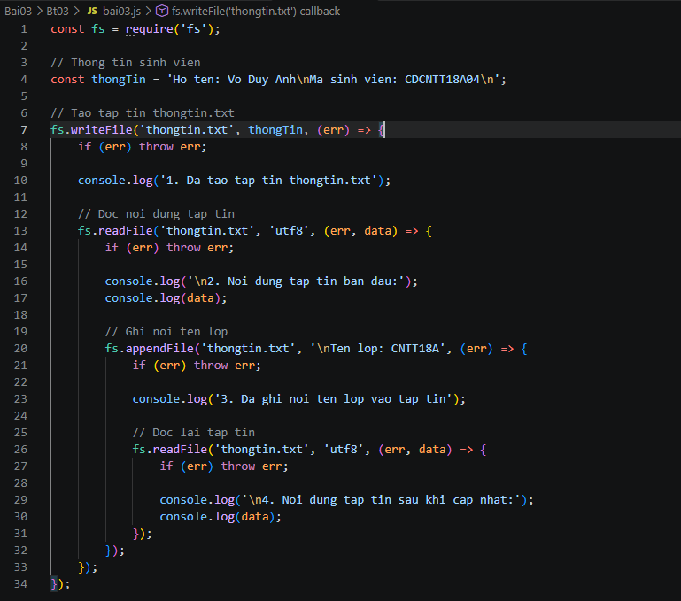
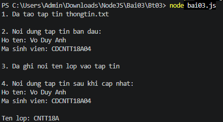
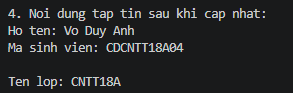

## 1. Các bước thực hiện

Bước 1: Tạo thư mục bài tập

mkdir Bai03

cd Bai03

mkdir Bt03

cd Bt03

Bước 2: Tạo tập tin bai03.js

notepad bai03.js

Bước 3: Chạy chương trình

node bai03.js

Bước 4: Kiểm tra tập tin thongtin.txt

Mở tập tin thongtin.txt để kiểm tra thông tin sau khi cập nhật.

## 2. Kết quả

Chương trình được viết và thực thi thành công bằng Node.js.

Tập tin thongtin.txt được tạo thành công bằng phương thức fs.writeFile().

Thông tin họ tên và mã sinh viên được ghi vào tập tin.

Nội dung trong tập tin được đọc thành công bằng phương thức fs.readFile() và hiển thị trên Terminal.

Tên lớp được bổ sung vào cuối tập tin bằng phương thức fs.appendFile().

Sau khi cập nhật, chương trình đọc lại tập tin và hiển thị đầy đủ thông tin gồm họ tên, mã sinh viên và tên lớp.

## 3. Hình ảnh thực hiện

Hình 1: Tập tin mã nguồn bai03.js

Hình 2: Kết quả chạy chương trình trên Terminal

Hình 3: Nội dung tập tin thongtin.txt sau khi cập nhật

